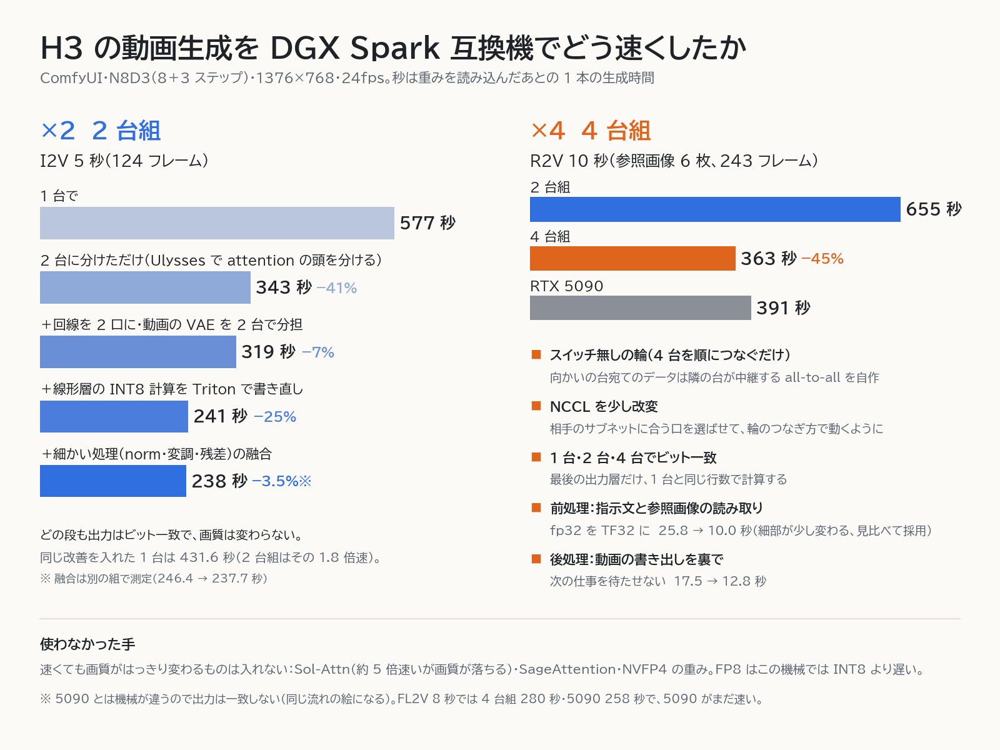

# DGX Spark 互換機で MiniMax H3 を速くする（2 台組・4 台組）

[English](README.md) | 日本語

MiniMax H3 の動画生成（ComfyUI）を、DGX Spark 互換機（GB10）を 2 台または 4 台つないで 1 本ずつ速く作るためのコードと記録です。

## 結果

| 動画 | 1 台 | 2 台組 | 4 台組 | RTX 5090 |
|---|---:|---:|---:|---:|
| I2V 5 秒（124 フレーム） | 431.6※ | 237.7 | 137.9 | — |
| FL2V 8 秒（192 フレーム、最初と最後の絵）† | — | 496.4※ | 279.7 | 257.9 |
| R2V 10 秒（243 フレーム、参照 6 枚） | — | 654.7 | **363.2** | 391.1 |
| R2V 10 秒・同じ指示文でシード違い | — | 641.7 | **345.7** | 383.9 |

- 単位は秒。ComfyUI の実行開始から完了まで。重みを読み込んだあとの 1 本。※ は起動直後の 1 本。
- R2V の 2 行は、前処理の TF32 と書き出しを裏で回す処理を入れた本番の設定。† の FL2V は、それらを入れる前の設定で測った。
- ビット一致（latent も mp4 も同じハッシュ）を確かめた範囲：I2V は 1 台・2 台組・4 台組、R2V・FL2V は 2 台組と 4 台組（1 台では作っていない）。RTX 5090 とは機械が違うので一致しない（同じ流れの絵になる）。
- 4 台組は R2V 10 秒で RTX 5090 より 7〜10% 速い。FL2V 8 秒は attention の割合が小さく、まだ RTX 5090 の方が速い。RTX 5090 も測るたびに 5% ほどぶれる。

## 前提

- 機械：DGX Spark 互換機（GB10、統合メモリ 128 GB、ConnectX-7 の 2 口）。台どうしは QSFP のケーブルで直結し、スイッチは使わない。
- ソフト：ComfyUI v0.42.3（H3 対応）、torch 2.11（CUDA 13.0）、Triton 3.6、comfy-kitchen 0.2.39。
- 重み：H3 の INT8 ConvRot 版（DiT 約 21 GB、Qwen3-VL の文章エンコーダ約 27 GB、動画・音の VAE、DMAD の 4 ステップ LoRA）。
- ワークフロー：N8D3（前段 8 ステップ＋DMAD の後段 3 ステップ）、1376×768、24fps。
- 1 台で H3 を動かすと 60〜70 GB を使う。大きな LLM と同じ台には載らない。

## 中身

| 場所 | 役割 |
|---|---|
| `comfyui_nodes/minimax-h3-sp/` | Ulysses（系列並列）の組用ローダーと worker。2 台組・4 台組。4 台の輪では中継つき all-to-all（`ring_a2a.py`）を使う。動画の VAE も台で分担する |
| `comfyui_nodes/h3-linear-fast/` | INT8 線形層の GEMM を Triton 版に差し替える（`int8_gemm_triton.py`）。worker 用には `boot/sitecustomize.py` から差し替える |
| `comfyui_nodes/h3-fuse-graph/` | DiT ブロックの norm・adaLN の変調・ゲート・残差を Triton の 3 カーネルに融合。worker 用の起動口は `boot/h3_fuse_launch.py` |
| `comfyui_nodes/h3-qwen-tf32/` | 文章エンコーダ（Qwen3-VL）のエンコード中だけ TF32 を許す。**これだけはビット一致しない** |
| `scripts/` | head と worker の起動スクリプト、4 台の輪の NCCL 設定の雛形（`nccl_ring4_env.sh`） |
| `bench/` | all-to-all の速さ（`a2a_bench.py`）、GB10 の行列計算の素の速さ（`gemm_peak.py`） |
| `tests/` | Triton GEMM と元の CUTLASS 経路のビット一致・速さ、RMSNorm 融合のビット一致 |

## 構成

| 構成 | つなぎ方 | 向いているもの |
|---|---|---|
| 1 台 | なし | シード違いの量産（台数ぶん並べる） |
| 2 台組 | 2 台を直結 | 1 本を速く。2 組・4 組と並べて本数も |
| 4 台組 | 4 台を輪に直結（A→B→D→C→A）。向かいどうし（A↔D、B↔C）はつながっていない | 1 本をいちばん速く |

- 分け方は Ulysses。attention の頭を台で分け、attention の前後で all-to-all を 1 回ずつ行う。
- ComfyUI は代表の 1 台（head）だけで動かす。残りの台（worker）は同じ DiT を読み込み、head の指示で forward の自分の分を計算する。text encoder と VAE の重みは持たない（動画の VAE の分担時は除く）。
- ワークフロー JSON の変更は、`UNETLoader` を組用のローダー（world_size と head のアドレスを持つもの）に置き換えるだけ。サンプラー 2 段と LoRA はそのまま動く。

## ×2：2 台組を速くした手順（I2V 5 秒、温まった状態）

| 手 | 1 本の時間 | 中身 |
|---|---:|---|
| 1 台 | 576.6 秒 | — |
| 2 台に分けただけ | 342.9 秒 | Ulysses。forward 1 回は attention 35%、MLP など 32%、qkv 15%、回線 13% |
| 回線を 2 口に | — | ケーブル 1 本の口に RDMA の機器が 2 つ見えるので、両方を NCCL に渡す（`NCCL_IB_HCA` に 2 つ並べる）。all-to-all が 12.9 → 20.6 GB/s |
| 回線と attention の重ね合わせ | — | 頭を 4 組に分け、送りながら計算する。GPUDirect RDMA が無い機械なので、隠れたのは 0.2 秒ほど |
| 動画の VAE を 2 台で分担 | 319.3 秒 | 時間方向のクリップを台で分け、head でつなぐ。約 30 → 13 秒 |
| 線形層の INT8 計算を Triton で書き直し | 240.9 秒 | 既存の CUTLASS の INT8 GEMM が sm121 で 75〜103 TOPS しか出ていなかった。Triton 版で 175〜193 TOPS。逆量子化の式と丸める位置を元と同じにした |
| 細かい処理の融合 | 237.7 秒※ | norm・adaLN の変調・ゲート・残差を Triton の 3 カーネルに。足し算の順と bf16 に丸める位置を PyTorch と同じにした |

※ 融合だけは別の組で測った（246.4 → 237.7 秒、−3.5%）。

- いちばん効いたのは線形層。この機械は CPU 側の遅れ（GPU の命令待ち）がほぼ無く、計算そのものを速くする手が効く。CUDA graph は効かなかった（消せる時間が forward あたり 0.05 秒しか無い）。
- 同じ改善を入れた 1 台は 431.6 秒（起動直後の 1 本）。2 台組はその 1.8 倍速い。

## ×4：4 台組の作り方（R2V 10 秒・参照画像 6 枚）

- **中継つきの all-to-all。** 輪なので向かいの台とは直接話せない。隣どうしの送受信だけで組み、向かいの台宛ての分は隣の台が受け取って次へ回す。K・V を全台に集める形（all_gather）も試したが、こちらの方が速かった。q 1 本（148 MB）の all-to-all が 7.5 ms。
- **改変版 NCCL。** 台ごとに口のサブネットが違うので、相手のサブネットに合う口を選ぶ改変版 NCCL 2.30.7（スイッチレスの輪に対応したもの）を `LD_PRELOAD` で差し込む。筆者が作ったものではないので、このリポジトリには NCCL のバイナリもソースも含まない。設定は `scripts/nccl_ring4_env.sh` を参照。起動時のやりとり（TCPStore・gloo・NCCL の bootstrap）は、4 台全部に届く管理用の LAN で行う。
- **1 台・2 台・4 台でビット一致。** cuBLAS の fp32 GEMM は行数によって計算の仕方を変えるので、最後の出力層だけは 1 台のときと同じ行数で掛ける。head は `--disable-cuda-malloc` で起動する（送受信に使った tensor の解放が cudaMallocAsync で失敗したため）。
- **動画の VAE は 4 台で分担。** 14 クリップを 4・4・3・3 で分ける。これが下限で、これ以上はクリップの中を分ける必要がある。
- **前処理：Qwen3-VL を TF32 に。** H3 用の文章エンコーダは内部を fp32 で計算していて、指示文と参照画像 6 枚の読み取りに 25.8 秒かかっていた。エンコードの間だけ TF32 を許すと 10.0 秒。細部がわずかに変わるので、見比べてから採用した。
- **後処理：書き出しを裏で。** 保存ノードはすぐ返し、mp4 は裏で仕上げる（変換の重ね合わせ＋x264 16 スレッド）。17.5 → 12.8 秒。手元の保存ノードへの改変なので、このリポジトリには含めていない。回収する側は、ComfyUI が終わったと返した時点では mp4 が書きかけなことに注意する。

## 使い方（概要）

1. 各台の ComfyUI の `custom_nodes/` に `comfyui_nodes/` の 4 つを置く。
2. 各台で環境変数を決める。
   - `H3_BASE`：venv・ComfyUI・models を置いたフォルダ。
   - `MINIMAX_SP_MASTER_ADDR`：head のアドレス。
   - `FABRIC_IF`・`FABRIC_HCA`：直結の口の名前。
   - 4 台の場合は、さらに `RING_NCCL_LIB`・`RING_IB_ADDR_RANGE`・`RING_MGMT_IF` も決める。
3. worker を先に起動する。
   - 2 台組：`scripts/start_sp_worker.sh start`
   - 4 台組：`MINIMAX_SP_FABRIC=ring4 MINIMAX_SP_WORLD=4 MINIMAX_SP_RANK=1..3` を付けて起動する。
4. head を `scripts/start_h3_sp.sh start` で起動する。4 台組では `MINIMAX_SP_FABRIC=ring4` を付ける。
5. ワークフローの `UNETLoader` を組用のローダーに置き換えて実行する。

スクリプトは筆者の環境向けに書いたもので、そのまま動く保証はありません。口の名前やフォルダの置き方は環境に合わせて直してください。

## 使わなかった手

| 手 | 結果 |
|---|---|
| Sol-Attn | 約 5 倍速いが、画質がはっきり落ちる |
| SageAttention2 | −3〜5%（組では −1〜2%）。画質が変わる（PSNR 約 30 dB） |
| SageAttention3 | 遅く、誤差も大きい |
| NVFP4 の重み（MLP だけ FP4 の混合） | かえって遅い（240.9 → 254.3 秒）。動きも変わる |
| FP8 | この機械の cuBLAS では BF16 より遅い（54〜65 TOPS）。INT8 が正解 |
| CUDA graph | H3 の DiT は ComfyUI の CUDA graph の対象外。効果なし |

attention は comfy-kitchen の INT8 がこの機械で約 155 TOPS 出ていて、INT8 GEMM の上限（170〜190 TOPS）に近い。

## つまずきやすいところ

- ComfyUI を `--base-directory` 付きで起動しているときは、重みと入力画像をそのフォルダの `models/`・`input/` に置く。
- 組で重み（I2V 用と R2V 用など）を替えるときは、組ごと止めて起動し直す。worker は起動したときの重みを持ち続ける。
- worker が落ちても、head は NCCL のタイムアウト（最長 15 分）まで気づかない。失敗したら組ごと起動し直す。
- 大量のファイルを写した直後は、ページキャッシュで統合メモリが埋まって CUDA の確保に失敗することがある。
- 解像度は 32 の倍数、フレーム数は 5＋17k（124・141・…・192・243）。
- 組で使えないもの：Fun ControlNet、Sparse Attention、動的な hook や patch。

## ライセンスと謝辞

- `comfyui_nodes/minimax-h3-sp/` は [buqi-code/buqi-minimax-h3-multigpu](https://github.com/buqi-code/buqi-minimax-h3-multigpu)（MIT）の `minimax_sp` を元に、別ホスト間の 2 台組・4 台の輪に作り直したものです。元のライセンスは `comfyui_nodes/minimax-h3-sp/LICENSE-buqi-code-MIT.txt`。
- それ以外のコードは MIT（`LICENSE`）。
- MiniMax H3 の重みとモデルの利用条件は、MiniMax の公式のライセンスに従ってください。
